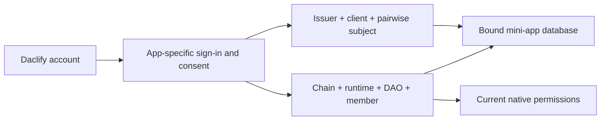

# Connected community apps

Status: registration, app sign-in, selected activity, matching connection bundles and Mini Apps discovery are implemented on the shared testnet. See [current status](current-status.md) for the dated package/capability checkpoint and qualification limits. Projects host their own apps and databases; mainnet is not qualified.

A community can build its own small application and use Daclify for account verification, DAO membership and selected governance records. The app keeps its interface, hosting and database. Daclify supplies the shared community relationship and records member-authorised submissions without copying the application's complete task database onto the blockchain.

For a concrete project specification, use the [example mini-app design](examples/community-mini-app-design.md). The [platform design](superpowers/specs/2026-10-11-connected-community-apps-design.md) describes the implemented boundaries across core, modules and frontend.

## Availability and first connection

| Capability | Availability | Boundary |
| --- | --- | --- |
| Registration, exact-callback login and app-bound Community Activity | Implemented on testnet | Current membership, app revision, signing grants and module pins remain authoritative |
| Connection configuration, immutable starter/SDK downloads and server readiness | Available on testnet | Persistent app hosting/database setup belongs to the builder; readiness is not a login/event test |
| SQLite and PostgreSQL recipes | Shared local conformance/restore checks pass | Other engines and every hosting/provider deployment are not thereby qualified |
| Mini Apps directory and local/HTTP MCP | Advertised by enabled deployment capabilities | A listing is not native registration; MCP needs separate supported scopes/harness consent |
| Encrypted profiles and optional account-exit orchestration | Implemented | Profiles need matching capabilities; account exit is currently disabled on the shared testnet |

## Register and connect your app

1. Create or choose a DAO with admitted members. Sign in as an active DAO administrator and open **Mini Apps → Connect an app**.
2. Choose the DAO. Use **Enable Community Activity**, or **Review Community Activity** if the deployment needs verification. A failed read offers **Retry app setup**.
3. When the module is ready, **Register or update an app** opens automatically if there are no apps. Use **Set up approvals** to configure or unlock an authorized signer.
4. Choose a numeric app ID, app name, approved HTTPS origin and exact HTTPS callback. The source API and cleanup endpoint are optional. Saving an existing ID updates its native revision; existing app sign-ins and recording grants must be renewed. Review the signed action before confirming **Register app**.
5. Select the registered app, choose **Get connection configuration**, and save the downloaded configuration. Use the exact callback and full issuer/client/chain/runtime/DAO/app binding.
6. Follow the matching starter/database instructions below. **Check app server** tests its persistent binding. Separately sign in as a DAO member, review consent, complete one synthetic item, and confirm its exact native receipt before using real records.

Daclify's owner is not a registration approver. Publishing a directory advertisement is optional and separate from registration and member consent. The [recipe](../examples/community-mini-app/README.md) includes SQLite/PostgreSQL conformance and restore evidence; the [agent example](examples/agent-publishing.md) distinguishes protected account login from scoped publication.

Use the [database and identity contract](guides/mini-app-database-contract.md) when designing any mini app. This applies to SQLite, PostgreSQL and another database engine; changing engines does not change the identity or privacy rules.

## App admission (development source)

The next development cohort adds opt-in app admission through the separate
core-owned `appjoin` contract. An administrator installs its exact reviewed
code and `admitapp` grant, then signs whether this app accepts public signup.
New public users and ordinary invitees become human, non-voting members.
Administrator invitations grant administrator and executive office plus voting
eligibility; the DAO's credit/stake rules still determine actual voting weight.
Returning members keep their existing identity and rights.

Invitations are signed by a current administrator in Daclify's trusted UI.
They expire within seven days, have a finite capacity and can be revoked.
The first eligible person holding the private link can accept its advertised
role. A token-derived browser signature binds the recipient's public identity,
chain, runtime, admission source, DAO, app revision and short expiry. Neither
the API nor the blockchain receives the raw link secret. The admission gateway
cannot mint privileged invitations or claim one without this signature.

The contract keeps the invitation claim, enrollment, voting restriction and
requested administrator/executive changes in one transaction. Active ballots
and pending executive handovers block privileged joins without consuming the
link. Issuer removal, app suspension/revision, inactive members and capacity
limits remain authoritative. Private content keys are granted separately.

Operators configure `CORE_APP_ADMISSION_ACCOUNT` only after deploying and
initializing the matched appjoin artifact and its normal code permission.
Native source permissions permit admission and the three role operations; they
do not permit spending or native account ownership changes. The governing
platform DAO cannot enable this shortcut. Root/module code pins must match.
This is development implementation, not activation on the shared testnet.

## Identity and recovery

The Daclify account is the canonical service identity. A client receives a pairwise app subject and the full native membership reference, not a global email-based app user. Keep issuer/client/subject separate from chain/runtime/DAO/member ID. Native IDs are validated decimal strings; the same member number in another DAO is another membership.

Account recovery and changes to paired sign-in methods do not create a new app user. Explicit reconnection preserves a sole subject mapping for the registered client and its native member anchor, then revokes old app authorization. Sign in and authorize again. If both profiles already have a subject for the same client, reconnection rejects rather than merging app histories. Never merge records by matching names, email or Telegram IDs. Two different registered root identities cannot be combined by this flow.



App login, recording grants, independent review/votes and decryption access are separate checks. Possessing an app subject or hosted account alias proves none of the other permissions.

## One community, several apps

A community creates a DAO and admits its members before connecting apps. A garden app, equipment booking app and volunteer rota can belong to the same DAO. Members join once and keep the same native member identity and voting weight across those apps.

Each app has a separate registration, source-record namespace, approved login callbacks, access settings and restricted signing permissions. Garden task 42 and equipment booking 42 are different records. Suspending the garden app stops its future access and recording authority without suspending the equipment app or removing community membership.

DAO membership establishes eligibility. Each app also enforces its business permissions, such as who can assign a task. Administrator/reviewer permissions and native executive office are distinct: becoming an executive does not automatically approve work in every app.

## Sign in and authorise actions

The Sign in with Daclify flow redirects to Daclify's trusted login screen. A previously paired, configured email or Telegram method can authenticate the existing account. The app receives a verified identity scoped to that app and checks active membership in its configured DAO. It receives neither the person's login pairing inventory nor their private signing or decryption keys.

Login and activity authorisation are separate. A member enables a short-lived signing credential restricted to the app, DAO, module and permitted actions through Daclify's existing supported signer. After setup, a Complete click can use that credential in the app browser. The first credential allows completion reporting and submission for review. Approvals and votes require their own displayed signing step.

Delegation authorises the app credential within those limits; it does not independently prove that a person inspected every field or clicked a particular button. A workflow needing confirmation of every event opens Daclify's trusted signing screen. The first delegated client keeps its private key in browser memory and requires renewed authorisation after losing it. App backends never hold that key.

The existing native session limit is sixteen per member, with a maximum seven-day lifetime. App registration alone uses no signing-session slot. Many registered apps do not imply unlimited simultaneously active signing credentials. Expiry, revocation, app suspension and member deactivation stop new recording under the applicable policy.

## Keep detailed data in the app

| Location                 | What belongs there                                                                                                                   |
| ------------------------ | ------------------------------------------------------------------------------------------------------------------------------------ |
| Mini-app database        | Tasks, descriptions, instructions, assignment, photos, current state and pending submissions                                         |
| Daclify service database | Registered clients, app-scoped identity/session state and recoverable delivery coordination                                          |
| IPFS                     | Selected preserved snapshots and evidence files, encrypted when protected                                                            |
| Native activity module   | Compact app/source references, source revision commitment, authorised member, event or decision kind and optional evidence reference |

Ordinary task creation and editing stay in the mini app. The first scope records selected completions, submitted reviews and decisions. Creating a task does not automatically allocate a Daclify task row.

Daclify can request current details from the app's authenticated API. A review instead uses the exact submitted source version and preserved snapshot, so editing the live task cannot silently change what a manager approves. Included photographs need actual file commitments; a mutable photo URL does not preserve the photograph.

Compact records still cost RAM. Native measurements and limits appear below. Each DAO/app needs explicit funded capacity, bounded identifiers and safe expired-grant cleanup. The first implementation retains completed receipts; the current Archive module does not automatically support their deletion.

## Public and private communities

Private DAO task details, photos and review contents are available only to authorised members. Protected snapshots and manifests are encrypted before public IPFS publication. An API login check alone cannot protect plaintext placed on IPFS.

A public DAO can publish selected information while keeping its operational apps private. Public visitors receive no membership, signing credential, review permission or voting authority. Every protected API read and write checks membership and the relevant app permissions; hiding controls in the browser is insufficient.

The public blockchain still exposes member identifiers, authenticated activity, timing, commitments and native voting outcomes. Private content does not imply anonymous governance. Removing a member restricts future access and key grants but cannot retract information or old keys they already obtained.

Signing credentials confer no decryption rights. The evidence viewer uses Daclify's trusted client boundary and separate app encryption/key grants, including for private evidence inside a public DAO. A mini app must not receive keys that unlock every other app's content.

## What happens when Complete is pressed

1. The app checks the signed-in member and task permission, then saves the local completion and a pending event together in its database.
2. It freezes the relevant task version and prepares any selected evidence snapshot, verifying the preserved bytes and references.
3. The browser signs the exact event using the member's restricted credential. The request binds the DAO, app, member, module, source revision, evidence, nonce and expiry.
4. Daclify checks native authority and resources, then records a compact receipt.
5. The app reconciles the receipt and changes Daclify confirmation pending to Recorded in Daclify only after the required confirmation.

The completer is the verified authorising member, separately from the assignee. Repeated delivery of the same logical event must not create another receipt. Local completion, IPFS hosting and native recording are separate systems: a durable outbox preserves pending work across failures, and a lost response requires reconciliation before retrying or signing a replacement.

A recorded completion is a member-authorised claim. Independent review can accept it or request changes; the record alone does not prove physical work or pay the member. If authorisation expires, evidence is unavailable or resources are exhausted, local work remains visibly pending for Daclify recording.

## Reviews and decisions

The implemented Community Activity module provides nonfinancial completion and review records reusable across gardening, bookings, volunteering and other app domains. Its initial review policy allows an authorised independent administrator or reviewer to approve or request changes; the submitter cannot approve their own request.

The integration uses one reusable activity smart contract, alongside app-specific signing restrictions in the existing runtime. A shared deployment can use the same activity contract for many DAOs and apps, isolating their records by runtime, DAO and app. It does not create a smart contract per mini app or task. An independent DAO deployment can use its own compatible module instance. Login and most app data remain off chain; native code and resource changes need their own qualification before deployment.

Decide can provide a community ballot linked to the exact app/source revision and evidence. Ordinary polls are advisory. The app backend applies a confirmed result under its explicit business rules and must not apply approval to a later edited revision.

Works remains a separate funded contribution workflow with positive milestone amounts and its existing reservation, review and settlement rules. A completion credential gives no spending, withdrawal or automatic payment authority.

## Developer integration

Use the connection returned by the trusted Daclify issuer, rather than copying version numbers or archive hashes from an old guide. Its `releaseId`, `coreVersion`, `modulesVersion`, `manifestHash` and `starterUrl` identify the exact bundle. Read `GET /v1/mini-apps/releases/:releaseId`, verify the manifest's SHA-256 against `manifestHash`, and verify each downloaded file's SHA-256 and byte length before extracting or running code. The manifest contains `core.tgz`, `modules.tgz` and `starter.tgz`; the starter includes its own locked vendor copies. Earlier URLs remain immutable.

Extract the verified starter into a new app directory, then follow its README: `npm ci --ignore-scripts`, `node configure.mjs connection.json`, and the recipe's build/hosting instructions. There is no general `npm start` script or managed Daclify database service. Persist the database and actual assets across app restarts. Never silently reuse a database under another issuer/client or DAO binding.

The SDK sample below illustrates a browser integration. `registeredClientId`, `callbackUrl` and `savedIntent` come from your registered client, exact login return and durable outbox. The `.example` domain is illustrative and must be replaced with your approved origin.

```ts
import { ConnectedAppClient } from '@daclify/core-protocol/connected-apps';
import { CommunityActivityClient } from '@daclify/modules/sdk';
const client = new ConnectedAppClient({
  issuer: 'https://testnet.api.daclify.com',
  clientId: registeredClientId,
  redirectUri: 'https://garden.example/callback',
});
// Keep this instance in the original browser tab, with the delegate key in memory.
const consentUrl = client.beginLogin({ recording: true, grantSeconds: 3600 });
// Open consent in a popup; the exact callback returns to the original tab.
await client.finishLogin(callbackUrl);
const activity = new CommunityActivityClient(client, 'daclifyactiv');
// Persist this intent in the project's outbox before sending it.
const result = await activity.deliver(savedIntent);
// result.status is confirmed only after the exact native event is read back.
```

Tokens use a five-minute access lifetime and rotating refresh credentials bounded by the native recording grant. Every protected call rechecks active membership, native app revision, credential generation and current code pins. A token is scoped to one app/DAO; it contains no paired email, Telegram ID, vault secret or treasury authority.

Administrators manage apps from the DAO's Connected apps tab. Native app registrations hold fixed IDs, target/revision/configuration commitment and enabled/security-generation flags; names, exact HTTPS callbacks and source API settings live in PostgreSQL. At most 64 apps can be registered per DAO. Each member has at most 16 native sessions and one current recording grant per app, with seven days maximum expiry. Expired cleanup is bounded to 25 rows.

The module retains at most 10,000 selected receipts and 128 encryption epochs per app. Compact source/event hashes carry no private descriptions or photos. First receipt/table overhead measured 1,225 physical RAM bytes in the owned native fixture; a second app receipt/count used 889 bytes. These measurements include table/index headers and are not public testnet timings. Capacity must be backed by the existing RAM model; permanent receipts are not erased to make space.

The optional source adapter serves current detail under short-lived membership access. Daclify labels a revision that differs from the receipt. The trusted snapshot screen accepts an immutable project outbox draft and selected files, encrypts the actual bytes using a separately granted app key, and sends ciphertext to the project's pinning adapter. The native receipt stores CID, byte commitment and epoch. Protected snapshots remain encrypted for public DAOs too. Missing pinning, an unavailable source API or an unavailable wrapped key is shown as unavailable; it does not invent historical evidence.

See the [runnable SQLite/outbox example](../examples/community-mini-app/README.md), the [project design template](examples/community-mini-app-design.md), and the producer-owned schemas in the [generated reference](generated/reference.md).

If configuration fails, check the exact issuer/client, callback/origin, full membership reference and matched package pins. If recording fails, distinguish inactive membership, suspended app, expired/revoked grant, changed nonce, incompatible code, unavailable evidence and exhausted capacity. A restart preserves a durable outbox but loses the browser-held delegate; renew consent before signing, and reconcile an uncertain previous submission first. Removing an identity link alone does not anonymize surviving tasks, photos, receipts or backups. Each app defines its own record audiences, finite retention and cleanup; native receipts are retained under the limits above.

## Connection bundles and starter downloads

An administrator retrieves `GET /v1/mini-apps/connections/:daoId/:appId` through the existing account session. The service derives the full binding, primary registered callback, frontend origin and native Activity account from the verified current registration. It checks current full DAO membership/admin authority and the exact selected public package versions. No root/signing key, app bearer or database/provider credential is included. A nonadmin or another DAO's administrator cannot export it.

The bundle links its immutable release manifest/starter and includes the manifest SHA-256. `GET /v1/mini-apps/releases/:releaseId` returns the exact hashed manifest bytes; `/files/core.tgz`, `/files/modules.tgz` and `/files/starter.tgz` stream only the selected verified files. A changed artifact is refused. Unknown release IDs or filenames cannot select another filesystem path. Build with `npm run package:mini-app-starter`; this writes a reviewed local candidate under `.artifacts/mini-apps/<releaseId>`, without publishing or deploying. The API operator mounts the approved release directory read-only and sets `MINI_APP_RELEASE_DIRECTORY` once for that deployment. Communities do not need the operator to manually issue each connection.

Before executing downloaded code, verify the manifest against the bundle's `manifestHash`, then each archive against its manifest entry. The starter vendors the exact public core/module archives and a locked dependency set. Its README walks through `npm ci --ignore-scripts`, `node configure.mjs connection.json`, durable SQLite/PostgreSQL hosting, TLS and first confirmed event. No sibling checkout or private registry account is needed after retrieval. Production SQLite requires explicit persistent-volume configuration and rejects known temporary paths. The example's public `/.well-known/daclify-mini-app.json` reports its bound namespace, with no secrets.

`POST /v1/mini-apps/connections/:daoId/:appId/check` requires the existing session, CSRF and current administrator authority. It probes only the declared source base's fixed readiness endpoint, using a validated pinned public IP, normal TLS verification, no ambient credentials/headers and no redirects. Loopback/private/link-local/reserved/mapped addresses, mixed private DNS answers and unsafe URLs are refused. Remote probes support standard HTTPS port 443, stop after five seconds and bound successful/error bodies to 64 KiB. DNS/source availability failures are separate from authorization. Node's [documented address filtering](https://github.com/nodejs/node/blob/main/doc/api/net.md#class-netblocklist) and [HTTPS request behavior](https://nodejs.org/api/https.html#httpsrequesturl-options-callback) underpin the standard-library transport; tests exercise the pinned Node 24 build.

Diagnostics show configuration, readiness, verified app identity and confirmed native event as separate stages. Successful readiness does not establish a login, a recording grant or a native receipt. The latter stages remain explicitly unrun until their real flows are performed. Use the exact immutable cohort selected by the returned connection configuration. The shared testnet serves its matched bundles and preserves earlier URLs; source conformance does not qualify every independently hosted app or production provider.

For cleanup registration, notice verification, app retention and restore exclusions, follow the [database cleanup contract](guides/mini-app-database-contract.md#cleanup-notices-and-restored-databases).
