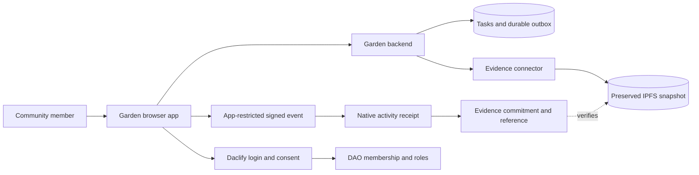

# Example mini-app design: Community Garden

Status: reusable project design example, 11 October 2026. All people, apps and tasks below are synthetic. Daclify's connected-app integration is proposed and unimplemented; this is a specification to adapt, not working sample code or a claim of available endpoints.

This example describes a small garden task app using Daclify for sign-in eligibility, community membership and member-authorised completion/review records. Replace the garden workflow with equipment bookings, volunteer shifts or another community process while preserving the identity, permission, privacy and delivery boundaries.

Read the [connected-app guide](../connected-community-apps.md) for the product overview and the [platform design](../superpowers/specs/2026-10-11-connected-community-apps-design.md) for Daclify implementation dependencies. A project can copy this document and fill in the adaptation checklist at the end.

## Intent and first scope

Seven people maintain a shared garden. They need a task list, photographs, assignment and a reliable record of who claimed completion and who reviewed that specific version. They also want a community vote for occasional shared decisions.

The first app supports sign-in, member-only task access, task creation/assignment, completion, submission for review and an optional decision link. It keeps its own small database. Only selected completion, review and decision records are linked to Daclify; ordinary edits and full task details stay local.

The DAO is created and the seven people are admitted before app access opens. Its complete reference identifies the chain, runtime, DAO ID and interface version. Production DAO creation, provider configuration and deployment require their separate authorised setup.

## Members and permissions

Alex and Jordan are the two managers. Sam, Casey, Riley, Taylor and Morgan are ordinary members. These are example display names; authority uses verified DAO member IDs.

| Person or audience | Local app permission | Daclify authority |
| --- | --- | --- |
| Active ordinary member | View tasks, complete permitted work and submit their completion for review | App-bound completion/submission credential after member consent |
| Alex or Jordan | Create/assign tasks and review another member's submission | Explicit administrator/reviewer permission and a separate review signing step |
| Eligible voter | Open the linked ballot and cast a vote | Existing DAO/Decide eligibility and a separate vote signature |
| Public visitor | View an explicitly published summary, if enabled | None |
| Nonmember or removed member | No protected task access or new actions | None |

The example allows active members to complete open or assigned tasks, with the actual completer recorded separately from the assignee. A manager cannot approve their own submission. One independent authorised reviewer is sufficient in this example; a project requiring both managers must define that different policy before implementation. Executive office alone grants none of these app permissions.

## Components and ownership

The example implementation choice is a TypeScript web app with one backend and SQLite on a persistent, backed-up volume. This is a suggested small-project baseline, not a Daclify requirement. A host with ephemeral storage needs a durable database instead. Framework choice does not change the integration boundary.

The mini app owns tasks, photographs, business permissions and its durable pending-event outbox. Daclify owns account authentication, verified DAO relationships, consent, native member authority and linked governance. An evidence connector prepares immutable snapshots and verified pinning. Provider credentials stay in backend configuration; root signing and decryption keys stay in approved client boundaries.

The platform proposal introduces a reusable Community Activity smart contract and changes the existing runtime to enforce app-bound grants. In a shared deployment, the garden and other community apps use that same contract with isolated DAO/app namespaces. The garden app does not deploy a contract for every task or require a separate contract simply because it is another app. Independent deployments may choose their own compatible module instance.



This diagram describes dependencies, not an atomic transaction. Private evidence encryption/key access is part of the connector and trusted evidence viewer design; it must be qualified before protected bytes are published.

## Sign-in and first authorisation

Sam selects Sign in with Daclify and authenticates at Daclify through a configured method already paired to Sam's account. The proposed registered-client code flow uses exact callbacks and verifies issuer, audience, state, nonce and PKCE. The garden backend creates its own protected session from the verified app identity and checks active garden DAO membership.

The app does not ask Sam for a Daclify password, recovery kit, Telegram pairing secret or root key. It receives only the approved app identity, DAO/member relationship and needed permissions. It does not build a second user registration, password-reset or pairing system.

Sam enables completion recording through Daclify's supported signer. The proposed grant is restricted to this garden app, DAO, installed activity module and completion/submission actions. Its private key stays in browser memory. It cannot approve reviews, vote, spend or act in another connected app. Losing the browser key requires renewed authorisation. Grants inherit the currently proposed sixteen-session/seven-day native limits.

A delegated signature proves use of an approved credential within scope, rather than independent proof of a physical button press. A project requiring per-event human confirmation opens Daclify's trusted signer for every event. Membership checks and appropriate signing consent remain separate from email/Telegram login.

## Small local data model

These are conceptual application records, not Daclify API schemas or a required SQL layout. Use stable opaque identifiers, optimistic revision checks and explicit bounds chosen for the project's needs.

| Local record | Minimum purpose |
| --- | --- |
| App identity/session | Verified issuer and app subject, configured DAO/member mapping, protected session expiry; no copied root keys or login pairings |
| Task | Random source reference, revision, title/instructions, assignee, local status and photo references |
| Completion submission | Stable event ID, frozen task revision, authorising member, completion claim and evidence choice |
| Durable outbox | Immutable submission intent, delivery state, verified snapshot reference, retry/reconciliation information and eventual native receipt identity |
| Review/decision link | Exact submission/source revision, native request or ballot reference and reconciled result |
| Photo/evidence storage | Actual files and immutable included-file commitments under the selected privacy and retention policy |

Display profiles and role projections are not authority. The backend verifies identity and relevant membership/permissions before protected reads and writes. The browser cannot supply a different completer ID, reviewer role or DAO and make it authoritative.

Save a local completion and its pending event in one database transaction. Preserve the submitted task revision even when the live task is edited later. A unique event identity prevents duplicate local submissions and links retries to the same logical native receipt. A stable source namespace consists of the complete DAO reference, registered app, record kind and opaque record ID.

The app's own API provides protected current-record reads, retrieval of the frozen submitted revision and conditional application of a confirmed result. Its developer chooses local routes and validates every boundary. Daclify-to-app access uses an explicitly scoped, audience-bound mechanism from the eventual integration specification; it does not reuse a member's full Daclify session cookie or disclose a server-wide secret to the browser. An unsigned webhook or caller-supplied Approved status is insufficient: reconcile the exact authoritative receipt or ballot result before applying it.

## Complete one task

The synthetic task is Trim and organise the chilli plants. It is open and unassigned. Sam opens its current revision and presses Complete.

1. The backend verifies Sam's current membership and completion permission, and conditionally checks the expected task revision.
2. It saves Completed by Sam and a pending immutable event together. It uses verified identity for the actor, independently of the editable assignee.
3. The connector freezes the relevant task contents and any selected photographs. Protected snapshots encrypt the manifest and actual included files before publication. Pinning includes retrieval and byte-commitment verification.
4. The browser signs a canonical completion request binding the chain/runtime/DAO, app, member, module/code revision, source revision, event identity, evidence commitment, native nonce and expiry.
5. Daclify checks authority, live membership, app state, code grants and resources, then records a compact receipt. The backend reconciles confirmation under the required finality policy.
6. The app shows Recorded in Daclify beside the local completion. The receipt identifies the authorising member and exact submitted revision without storing the task's title, instructions or photographs on chain.

Illustrative event contents follow. Angle-bracket values are placeholders, and the field names are explanatory rather than a published request schema. Do not POST this object to an invented endpoint. A versioned SDK must supply the eventual canonical encoding and signing envelope.

```json
{
  "eventId": "<unique opaque completion event>",
  "dao": {
    "chainId": "<configured native chain ID>",
    "contract": "<configured runtime>",
    "daoId": "<garden DAO ID>",
    "interfaceVersion": 1
  },
  "appId": "<registered garden app ID>",
  "source": {
    "kind": "task",
    "id": "<random opaque task reference>",
    "revisionCommitment": "<commitment to the submitted version>"
  },
  "eventKind": "task.completed",
  "actorMemberId": "<member bound to the verified signer>",
  "evidence": {
    "cid": "<verified snapshot reference, when selected>",
    "commitment": "<commitment to preserved bytes>",
    "encrypted": true
  }
}
```

A completion may omit optional evidence. A submission intended for review must preserve the exact contents the reviewer will accept; a live URL alone is insufficient. A signature records an authorised claim, not proof that gardening occurred.

## Reviews and shared decisions

Sam submits the completion for review. Alex opens the exact submitted revision and evidence through the trusted evidence viewer, then separately signs Approve or Request changes. The app accepts only a result bound to that submission, DAO and app. Sam cannot self-approve, and Alex's garden permission cannot review a booking in another app.

If the task is edited while review is pending, the earlier submission remains immutable. Approval applies to the earlier revision. The app displays the version mismatch and requires a new submission for the edited work; it never automatically marks the new revision approved.

For a community question, such as whether to change a shared planting plan, the app links an exact Decide ballot and evidence commitment. Eligible members vote through Daclify. Once a confirmed result is reconciled, the app backend applies it through a conditional local update under its business rules. Ordinary polls remain advisory and do not directly execute SQL, accept arbitrary tasks or make payments.

The first example has no payment workflow. Funded milestones belong to Works and require their separate amount, reservation, review and settlement rules.

## Public/private configuration

For a private garden DAO, task details, photographs, review text and decrypted snapshots are protected member content. Public IPFS holds encrypted evidence. Protected read APIs check current membership and app permissions; sessions do not grant indefinite access after removal.

For a public garden DAO, the same member-only operational app can expose an optional published progress summary. Publication requires an explicit permitted choice. Unpublished tasks and photos remain protected. A visitor can read only published material and cannot complete, review or vote.

Private evidence in a public DAO depends on the proposed app encryption envelopes/key grants; it cannot use the existing public DAO document path as if that path encrypted content. The first evidence viewer stays in Daclify's trusted client boundary. Direct mini-app decryption needs separately qualified app-scoped consent and key access. No app obtains keys for all the DAO's other apps.

Membership, authenticated actor identifiers, native transaction timing, commitments and native voting outcomes remain observable on the public ledger. Use opaque random task references rather than a guessable hash of task number 42. Removing a member restricts future access and applicable key epochs; it cannot erase previously obtained information.

## Delivery failures and recovery

| State or failure | Expected behaviour |
| --- | --- |
| Saved locally | Show Completed by Sam; Daclify recording is pending |
| Evidence unavailable | Retain the frozen submission and pending event; do not claim evidence-backed confirmation |
| Signature/grant missing or expired | Ask the member to reauthorise through Daclify; backend retries cannot create signatures |
| Broadcast response lost | Reconcile the event/transaction before submitting again |
| Native nonce changed by another app | Reconcile any uncertain broadcast, reread the nonce and obtain a fresh signature |
| Native resources exhausted | Keep local work pending and identify the required capacity; preserve existing receipts |
| Receipt confirmed | Record the complete receipt/source identity and display confirmation |
| App suspended or member removed | Stop new protected access/actions under the configured policy; keep historical receipts |

The backend may retry delivery of valid signed bytes but cannot modify them or extend expiry. It keeps a durable outbox across restarts, reconciles uncertain submissions and uses a conditional source-version update when applying results. A single event is recorded once across repeated Complete clicks, retries and lost responses.

Back up the local database and photographs, issuer/app registration state and the required encryption recovery material. Keep verified pins or independent evidence exports. A native receipt cannot recreate a lost task database, and a CID alone does not guarantee content availability. Report missing source content or decryption keys explicitly.

## Several apps and resource limits

The garden DAO can later register an equipment app using the same seven members. That app has a distinct identity, namespace, callbacks, grants and business permissions. It creates no second membership or extra voting weight. Garden credentials cannot sign equipment events, and disabling one app leaves the other operational.

Share member nonce coordination through the qualified SDK rather than assuming independent nonce counters per app. Registration is separate from active signing-session capacity. Native app/grant/receipt fields and indexes need bounded resource budgets, pinned CDT `-O=s` measurements and explicit exhaustion behaviour. This example promises no unmeasured per-task RAM price or unlimited history.

## Acceptance before real users

- Members can sign in through qualified paired providers; nonmembers and removed members cannot access protected tasks.
- An unassigned task records the actual completer. Forged member IDs and stale task revisions are rejected.
- Cross-app/cross-DAO credentials, suspended apps, revoked/expired keys and wrong module code cannot record events.
- A self-review is rejected. Approval of one revision cannot approve another revision or unrelated task.
- Duplicate events, lost responses, simultaneous activity in two apps and database restart preserve once-only recording and honest pending/confirmed states.
- Private manifests and files contain no protected plaintext on IPFS, native payloads, public previews or ordinary logs. Public visitors get only explicitly published material.
- App decryption access is isolated. Lost keys and removed members are handled without claiming historic erasure or invented recovery.
- Native resource measurements and exhaustion checks pass, and backups restore the local database plus surviving evidence independently of receipts.
- The sign-in, authorisation and pending/review states remain usable by keyboard and on mobile.

These are required future checks, not tests passed by this document. Current Daclify foundations do not establish live external-app/provider qualification.

## Adapt this design for your project

Copy the document, replace the synthetic garden workflow and record these project choices:

| Choice | Garden example | Your project must specify |
| --- | --- | --- |
| Community | Seven members, two explicit managers | DAO reference, admission and role rules |
| Local records | Tasks and completion submissions | Record types, stable identifiers and version rules |
| App actions | Completion and submission; separate review/vote signing | Permitted actions and per-event confirmation requirements |
| Review | One independent authorised reviewer | Reviewer eligibility, thresholds and conflict rules |
| Evidence | Frozen task revision and selected included photos | Required snapshot contents, privacy, key access and retention |
| Public content | Optional published progress summary | Allowed audience and explicit publishing authority |
| Result application | Conditional update of the exact submitted revision | Business effect, rejection/reopen rules and reconciliation |
| Operations | Persistent SQLite plus backed-up files | Durable hosting, backups, resources and responsible operator |

Keep endpoint names, SDK calls and deployed native accounts unspecified until the connected-app release publishes producer-owned schemas and compatibility pins. Local app work can follow this design, but real Daclify integration requires that qualified release. This document grants no production deployment or account-authority changes.
