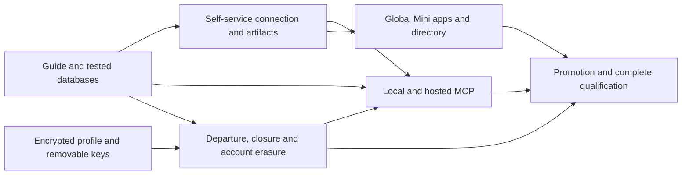

# Self-service Mini Apps and Account Exit Implementation Plan

> **For agentic workers:** REQUIRED SUB-SKILL: Use `superpowers:executing-plans` inline, task by task. Workspace instructions prohibit delegation. Track the checkboxes in the linked plans and the ledger below.

**Goal:** Let communities connect mini apps and AI harnesses without the Daclify owner's help, while providing private on-chain profiles and truthful, safe account exit.

**Architecture:** Extend the existing connected-app, identity, native governance and PostgreSQL job infrastructure. Mini apps retain their own hosting and databases; Daclify supplies verified identity, scoped authority and selected receipts. A global frontend destination, public artifacts and local/hosted MCP expose those capabilities through the same canonical contracts.

**Tech Stack:** Antelope C++/pinned CDT, strict TypeScript, Node 24.21.x, PostgreSQL, Node SQLite, Vue/Pinia/Vue Router, Vitest, Playwright, the stable MCP TypeScript SDK and the existing static website/export tools.

**Spec:** [Full design](../specs/2026-10-12-self-service-mini-apps-and-account-exit-design.md). Also consume the concurrent [account continuity design](../specs/2026-10-12-account-access-continuity-design.md); do not reimplement or overwrite it.

## Global Constraints

- Work inline. Core/modules/frontend changes integrate on `dev`; the website uses `main`. Preserve concurrent edits and all six legacy repositories. Commit only task-owned files.
- The user personally performs no registration, package delivery, manual configuration or routine support. Community consent and builder configuration are normal self-service steps.
- Personal profile contents stay encrypted on chain. Only the owner and expressly authorized people receive keys. Profile keys are independent random keys, separate from signing and DAO document keys; no second password or recovery kit.
- Hosted profile-key envelopes are removable off chain. Existing plaintext, historical ciphertext, exported keys and recipients' copies cannot be promised erased.
- Offer sole-member DAO closure during account deletion. Never implicitly burn claims, transfer funds or dispose of remaining assets.
- Native authorization, backed liabilities, replay protection, private-history handover and recovery survive retries and upgrades. Neither SQL deletion nor browser state substitutes for native checks.
- Compile current contracts/probes with pinned CDT `-O=s`; preserve historical fixture flags/hashes. Bound stored values, justify indexes, provide eligible-record cleanup and measure WASM/RAM/native action CPU.
- Use producer-owned schemas/ABIs and exact public artifact pins. No application `any`, unchecked boundary casts, TypeScript suppressions, arbitrary module UI execution or private cross-repository imports.
- Reuse PostgreSQL leases/jobs and current services. No new hosted database product, Redis, queue or independent signer service in this scope.
- Record actual results, including blocked/unrun checks. Development does not authorize production deployment, real account erasure/closure, authority changes, asset movement or website publication.

## Review Focus

1. A database reopened against another DAO or app must refuse the binding before returning records — F2/F3.
2. A recovered/reconnected account must retain the right app records without merging another person's history — F3/X2.
3. The last member's departure must preserve claims and controller/private-history continuity — X1/X3.
4. An old recovery kit or restored backup must not silently undo controlled profile-key deletion — P2/X2/Q2.
5. A model/harness must not widen permissions or reuse credentials for another DAO/resource — M1–M4.

## What exists, what changes

The inspected source already implements connected apps, their exact-origin login, narrow Activity grants and a DAO Connected apps screen. The handbook still describes them as proposed, and guide/example pins lag later rollout evidence. Current source versions include concurrent work; a newer package number is not qualification evidence.

A disposable reproduction showed the SQLite example returning the first DAO's pending completion when reopened with another DAO sharing its member number. It also exposed the previous task under a changed app ID. Fix persisted binding first. This finding is not evidence of a native authorization bypass.

The agent example sends an incomplete challenge and needs complete root-authentication versus delegate-signing verification. There is no qualified MCP server in the inspected implementation. Profiles currently write public plaintext; ordinary self-departure, account erasure and DAO closure require new authoritative behavior. Activity receipts currently have no pruning lifecycle.

This is an execution-ready proposal, not a claim that those additions have shipped. Engineering defaults below are recommendations implementing the conversation; directory moderation and transport order were not separately selected by the user.

## Workstreams and delivery order

| Plan                                                                              | Tasks | Independently reviewable outcome                                                      | Depends on                                      |
| --------------------------------------------------------------------------------- | ----- | ------------------------------------------------------------------------------------- | ----------------------------------------------- |
| [Foundation and databases](2026-10-12-mini-app-foundation.md)                     | F1–F4 | Accurate guide; safe SQLite/PostgreSQL starters; complete agent example               | Baseline B0                                     |
| [Connections and discovery](2026-10-12-mini-app-connections-and-discovery.md)     | C1–C3 | Downloadable config/artifacts, diagnostics, Mini apps page and self-service listings  | F1–F3; C3 follows C2                            |
| [Encrypted profiles](2026-10-12-encrypted-on-chain-profiles.md)                   | P1–P3 | Versioned encrypted on-chain writes, authorized sharing/recovery and live-row removal | B0/account continuity                           |
| [Account exit and DAO closure](2026-10-12-account-exit-and-dao-closure.md)        | X1–X4 | Native departure/closure, resumable erasure, app notices and account UI               | P1/P2; F2/F3 for X4                             |
| [Community MCP](2026-10-12-community-mcp.md)                                      | M1–M4 | Tested local and hosted connections with scoped signer boundaries                     | F4/C1; X2 for revocation/deletion qualification |
| [Promotion and qualification](2026-10-12-mini-app-promotion-and-qualification.md) | Q1–Q3 | Multilingual promotion, complete journey evidence and immutable release candidate     | All preceding acceptance gates                  |

Execute F1→F2→F3→F4→C1→C2→P1→P2→P3→X1→X2→X3→X4→M1→M2→M3→M4→C3→Q1→Q2→Q3. Dependencies permit a different inline order if it makes integration simpler; update the ledger first. Directory discovery and website work must not delay fixing the known database gap. Hosted MCP is a planned deliverable, with its own authorization gate, rather than a vague future promise.



### B0: Record the execution baseline

**Files:** Create `docs/evidence/2026-10-12-mini-app-execution-baseline.json` and `docs/evidence/2026-10-12-mini-app-execution-ledger.md` in core. Modify this plan's ledger only to record actual progress.

- [ ] Record branch/HEAD/status for core, modules, frontend and website; current package versions; toolchain pins; known concurrent account-continuity ownership; qualified release manifest hashes versus unqualified working source. No secrets in evidence.
- [ ] Read each repository's `AGENTS.md`, the canonical programme/release policy and relevant scoped plan before its first edit. Read Garden Care's `AGENTS.md` and `HANDOFF.md` before any optional preview work.
- [ ] Resolve the next unused migration number at execution time. Reserve distinct additive migrations for directory discovery, profile keys, erasure and MCP pairing/OAuth; never edit published migration hashes or collide with concurrent `041_account_reconnect.sql`. `NNN` in a subplan is an allocation instruction, not a literal filename: replace it in the ledger before editing. Starter database migrations stay inside their independent app recipe.
- [ ] Set up disposable local integration databases whose names end `_test`, and isolated native/browser fixtures. Integration guards must reject other database destinations. Never reuse Garden Care's normal fallback data directory.
- [ ] Run the existing focused baseline: `npm test -- tests/community-mini-app.test.ts tests/connected-app-client.test.ts tests/connected-apps-protocol.test.ts tests/connected-app-contract.test.ts`. Save actual results and note existing failures without attributing them to new work.

## Canonical interfaces connecting the workstreams

All names in this section are **proposed additions** until their owning task implements, tests and exports them. Existing endpoint/action names are identified in the subplans. Core owns the shared types; clients consume their versioned public package.

```ts
type AppBinding = {
  schemaVersion: 1;
  chainId: string;
  runtime: string;
  daoId: string;
  appId: string;
  issuer: string;
  clientId: string;
};
type AppActor = { binding: AppBinding; subject: string; memberId: string };
type CleanupNotice = {
  version: 1;
  eventId: string;
  binding: AppBinding;
  subject: string;
  memberId: string;
  kind: 'membership-left' | 'account-erased';
  issuedAt: string;
  expiresAt: string;
};
type ExitIntent = {
  version: 1;
  mode: 'leave-all' | 'delete-account';
  memberships: Array<{
    chainId: string;
    runtime: string;
    daoId: string;
    memberId: string;
    choice: 'leave' | 'handover' | 'close';
  }>;
};
type ErasureComponentState = 'pending' | 'confirmed' | 'unavailable' | 'retained';
```

F2 validates `AppBindingSchema`/`AppActorSchema` and exports `appBindingHash(binding)`; X4 owns `CleanupNoticeSchema` and signed notices; X2 owns `ExitIntentSchema` and the component status/report schema. P1 owns `ProfileContextSchema`, `EncryptedProfileSchema`, `ProfileKeyGrantSchema` and profile cipher/key helpers. M1 owns `McpConnectionSchema`, `McpToolInputSchemas` and `CommunitySigner`. Do not reproduce these interfaces independently in the frontend, starter, modules or MCP package.

IDs use the existing lossless uint64 decimal-string schema; never browser floating-point identifiers. The binding hash uses canonical ordered serialization of all seven binding fields and SHA-256, excluding mutable app revisions. An issuer/client/DAO change requires a reviewed migration, never silent rebinding. Native membership references remain historical anchors across account aliases; application subject changes require verified relinking.

## Decisions made for execution

- **Database:** one dedicated bound SQLite database in the lightweight starter; one PostgreSQL starter supporting multiple fully namespaced tenants. They share conformance requirements, not a speculative ORM. SQLite WAL remains on one host; PostgreSQL is the documented option for multiple workers/hosts.
- **Profile keys:** random 32-byte keys generated in the trusted client. Owner and selected recipients get encrypted envelopes bound to exact profile context/version and recipient key. The existing API PostgreSQL service stores envelopes, never plaintext profile fields or raw keys; default recipient limit is 64 including the owner. Deleting keys includes all controlled envelopes/caches/backups. Loss of every envelope/key means loss of profile readability.
- **Profile format:** explicit encrypted version 2 with AES-256-GCM, 12-byte IV and context-bound authenticated data; reuse audited existing P-256/HKDF key delivery primitives with a separate profile domain. Maximum plaintext 4,096 UTF-8 bytes; maximum stored envelope 8,192 UTF-8 bytes. Keep existing legacy serialization/readers and measure the real overhead.
- **Identity visibility:** public native identifiers and a user-chosen public account alias may remain public. Real name, contact details, location, biography, social links and sensitive image references are inside the encrypted payload. Explain this before a profile write; no default publication of personal fields.
- **Listings:** recommended policy is self-service maintainer/origin verification, bounded submissions and community moderation/reporting. Listing proves a maintainer controls a listing/origin, not platform endorsement, security certification or DAO authority. Use existing platform governance/role policy for moderation; no permanent founder inbox.
- **MCP:** local stdio first, hosted Streamable HTTP second; same bounded capabilities. Pin stable SDK `@modelcontextprotocol/sdk@1.32.1`, verified 12 October 2026, in a separate package with public Daclify pins. If official support has changed when executing, revalidate and record any replacement pin before implementing.
- **Hosted signing:** remote tools prepare intents and may submit an already signed permitted intent. Signing occurs in the user/community's supported companion or protected harness; the hosted MCP service never receives root/private signing keys. An HTTP-only harness without a compatible signer qualifies for read/prepare, not autonomous submission.
- **Local signing:** after trusted consent, a protected local signer can execute only the selected routine proposal/activity/vote/review scopes through `submit_prepared`. No private key enters model text and no arbitrary-sign tool is exposed. Human-assisted confirmation and agent autonomy follow the selected consent/DAO policy; administrative roots stay outside MCP.
- **Retirement:** active→closing→closed native DAO lifecycle. Closing prevents new commitments but allows already authorized settlement, claim withdrawal, unstaking, evidence/reconciliation and safe handover. Final closure requires zero unresolved liabilities/locks and an independently valid native controller.
- **Retention:** no invented universal retention period. Each actual personal-data class needs a purpose, accountable party, expiry and legal exception. If missing, affected public release is blocked while independent engineering continues.

## Verification and evidence

| Requirement                                    | Owning tasks   | Required evidence                                                                                    |
| ---------------------------------------------- | -------------- | ---------------------------------------------------------------------------------------------------- |
| Fresh community requires no owner intervention | F1/F3/C1/C2/Q2 | Clean-machine artifact install, admin config, member login, native receipt                           |
| SQLite/PostgreSQL identity and tenancy         | F2/F3/X4       | Wrong-binding rejection, forged actor, uint64 extremes, concurrent/outbox/restart/restore tests      |
| Account continuity                             | F3/P2/X2       | Existing recovery/reconnect tests plus canonical/retired alias and app subject continuity            |
| Private on-chain profile                       | P1–P3          | Cipher vectors, authorized audiences, chain/API/bundle plaintext scans, actual WASM upgrade          |
| Controlled profile erasure                     | P2/X2/Q2       | Envelope purge, backup-expiry inventory, restore-before-serve exclusion, copied-key limit explained  |
| Self-departure/sole-member closure             | X1/X3          | Native signatures, successor/private-history/controller checks, retained financial exit rights       |
| Truthful account deletion                      | X2–X4          | Fault injection/restart, finite jobs/notices, incomplete app/native/legal states reported            |
| Mixed/guarded-agent MCP                        | M1–M4          | Actual SDK clients/signers, guardian pause, expiry, audience/DAO replay and private-content controls |
| Storage/RAM/CPU                                | F3/P1/X1/Q2    | SQLite/PG maintenance evidence; before/after native rows/RAM; WASM and action CPU samples            |
| Public claims match product                    | F1/C2/C3/Q1/Q3 | Generated and explanatory docs, UI help links, en/es/pl HTML/Markdown/LLM export checks              |

Unit/emulator coverage does not replace native permissions, live provider or supported-harness evidence. Use synthetic fixture data; record each environment and missing external dependency. No full-suite success claim when required suites are absent, empty or skipped.

## Delivery, rollback and release boundaries

Prepare additive database migrations, legacy profile decoders, pinned ABI/schema artifacts and feature gates. Enable encrypted profiles only when the full write/key-recovery path passes; disable new writes if key custody fails. A rollback must preserve existing ciphertext/key access, pending jobs, financial rights and committed native records; it cannot restore a deliberately purged key or reverse confirmed chain history.

Before any authorized rollout, compare immutable supported releases, rehearse upgrade/restore with outstanding receipts/claims and publish a user-readable capability matrix. New registration, listing and MCP features can remain disabled while existing app login/Activity continue. DAO closing is a native state transition, not a reversible UI toggle. Account-erasure jobs reconcile submitted transactions before retry and never reconstruct deleted personal fields from projections.

Q3 prepares a source-bound release candidate and a concrete rollout/rollback runbook. Production deployment, website publication, live changes and irreversible actions require the user's separate instruction; local fixture operations do not.

## Execution ledger

At authoring time only repository investigation and this design/planning work are complete. Every implementation task below is pending.

| Package | State             | Evidence/commit                                      |
| ------- | ----------------- | ---------------------------------------------------- |
| B0      | Pending execution | Baseline must be recorded when implementation starts |
| F1–F4   | Pending           | —                                                    |
| C1–C3   | Pending           | —                                                    |
| P1–P3   | Pending           | —                                                    |
| X1–X4   | Pending           | —                                                    |
| M1–M4   | Pending           | —                                                    |
| Q1–Q3   | Pending           | —                                                    |

Update the durable ledger after each task with commands, passed/failed/unrun results, changed files, immutable artifact references and any material policy/access blocker. Continue independent work when one release qualification is blocked. No repeated internal checkpoint approvals and no sub-agent delegation.

## Scope deliberately deferred

Managed mini-app database hosting, arbitrary engine certification, a commercial customer-order platform, general autonomous-agent orchestration, unrestricted MCP tools and Activity receipt pruning are separate projects. Existing Activity limits and funded capacity must be documented; pruning may be designed only after measured usage, preserving replay and review/settlement interpretation. Garden Care is an optional isolated preview after the synthetic starter qualifies, not a prerequisite and not authorization to change its production service.

## Inline plan review

Check spec coverage, existing-versus-proposed file/API names, cross-plan type consistency, each Review Focus regression, migration allocation, single-kit recovery/deletion limits and release gates. Record only checks actually performed. The linked task plans supply exact file maps, interface ownership, failing-test assertions, commands and commit boundaries; implementations remain pending.

The authoring review covered all design requirements and all 21 task interfaces inline. It corrected missing public exports, the issuer/client context absent from existing app claims, the canonical lowercase instruction type, the hosted MCP service adapter, local bounded signing and key-envelope size limits. Verification checked all eight documents, 30 local links, 76 existing source paths and task/checklist structure; Markdown formatting passed. No product code, migration, contract, browser or external-harness qualification was performed by writing this plan.
